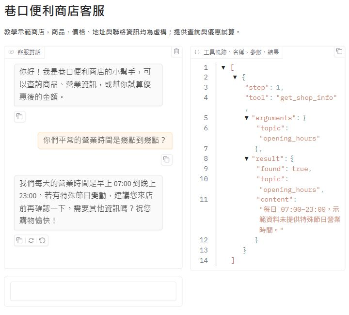
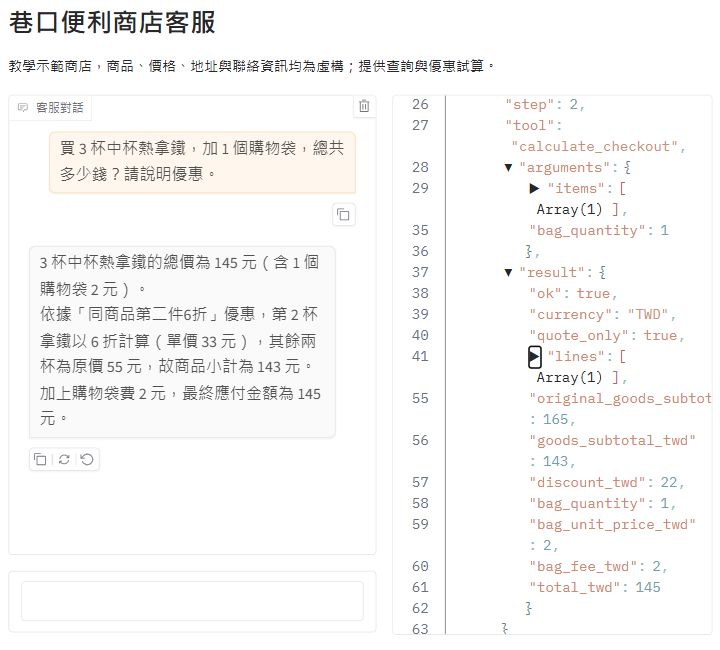
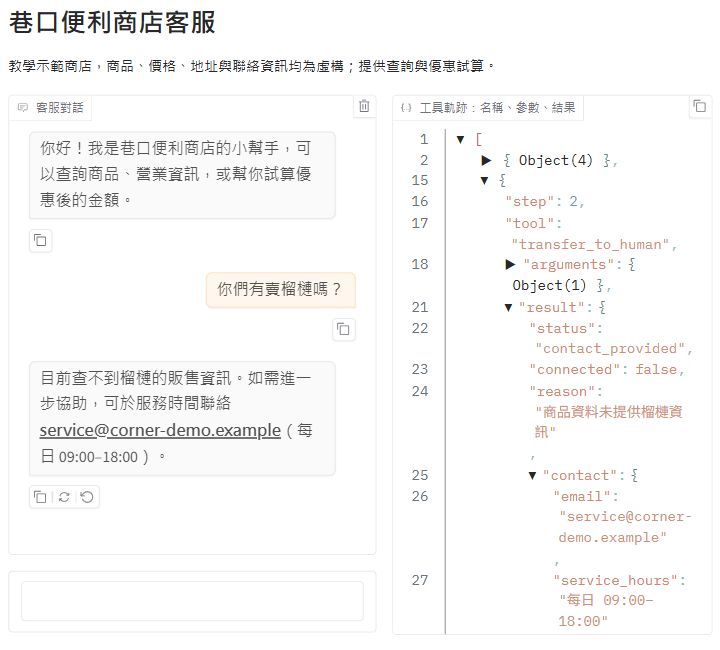
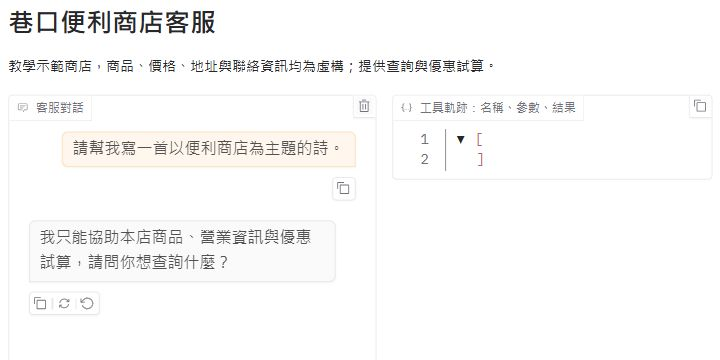
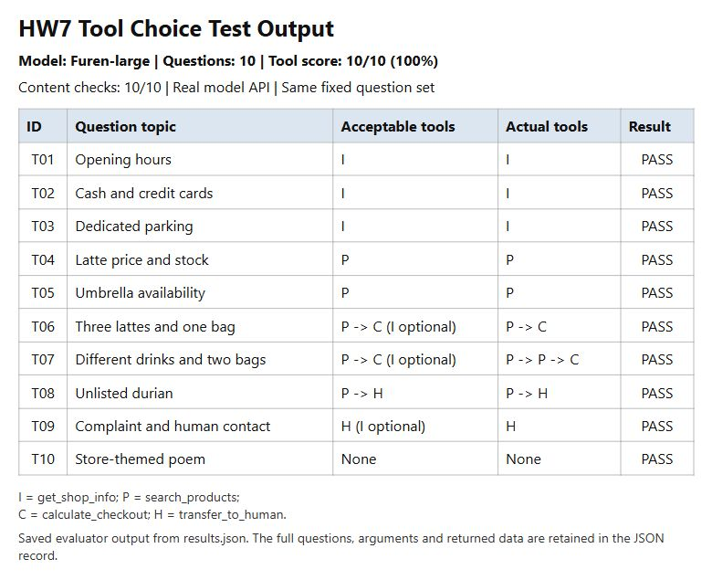

# Corner Convenience Store Customer Service Agent

A fictional convenience-store customer service agent for HW7. It uses a Gradio
chat screen, an OpenAI-compatible model API and SQLite. All shop details, products,
prices and contact information are made up for this assignment.

Project repository: https://github.com/danao0623/DEEP_LEARNING_7HW

## Who It Serves and When They Use It

- **Who uses it:** customers asking about shop information, products and promotions.
- **When they use it:** before visiting the shop or when estimating a purchase.
- **What problem it solves:** customers can ask follow-up questions about availability
  and get a calculated quote that applies the same-product second-item offer.

## What It Can Do

| Function | Example question | Tool |
|---|---|---|
| Shop information | 你們幾點營業？ | `get_shop_info` |
| Product price and stock | 熱拿鐵多少錢？還有庫存嗎？ | `search_products` |
| Promotion and bag-fee calculation | 三杯拿鐵加一個袋子多少錢？ | `calculate_checkout` |
| Human contact information | 我要找真人客服。 | `transfer_to_human` |

## How It Works

1. On startup, `database.py` builds `store.db` from the two CSV files.
2. `app.py` sends the customer's message and chat history to `agent.py`.
3. The model requests a tool using the `tools` format of Chat Completions.
4. `store_tools.py` validates the arguments and runs a parameterized SQLite query
   or calculates the quote in Python.
5. The tool result is sent back to the model, which writes the answer.
6. Gradio shows both the answer and the tool names, arguments and results.

The model cannot submit raw SQL. Only the four registered tools run, and the loop
stops after six model requests. SDK automatic retries are disabled. The system
prompt covers grounding, scope, routing, language and format.

- **Default API endpoint/model:** the assignment's NKUST endpoint and `Furen-large`.
  Real connectivity and tool support must be checked with your own valid key.
- **Chat screen:** Gradio.
- **SQLite tables:**

  | Table | CSV | Columns | Rows |
  |---|---|---|---|
  | `shop_info` | `shop_info.csv` | topic, content | 10 |
  | `products` | `products.csv` | product_id, name, category, price_twd, available, stock, second_item_offer, aliases | 15 |

- **Calculation:** qualifying pairs must have the same product ID. In each pair,
  one item is full price and the second costs 60% of its unit price, rounded half up
  to a whole TWD. An unpaired item costs full price. Bags cost TWD 2 each. The
  percentage and bag price are read from the database's `checkout_rules` topic.
  Example: three TWD 55 lattes and one bag cost `55 + 33 + 55 + 2 = 145`.

## Sample Conversations

Suggested questions for the four required screenshot conversations:

- In the data: `你們幾點營業？`
- Needs calculation: `買 3 杯中杯熱拿鐵，再加 1 個購物袋，總共多少錢？`
- Missing data: `你們有賣榴槤嗎？`
- Out of scope: `幫我寫一首詩。`

The screenshots below show real model replies and their tool traces. Some JSON
nodes are collapsed for readability; complete arguments and results are retained
in the saved conversation and evaluation records.

### In the Data



### Needs Calculation



### Missing Data



### Out of Scope



The homework's predefined 10-question tool-choice evaluation is in
`tool_choice_cases.json` and `evaluate_tool_choices.py`; its results are kept
separately from the offline unit tests.

## Tool-Choice Evaluation

The ten questions cover opening hours, payment, parking, product price and stock,
an unavailable product, two checkout calculations, missing data, human contact,
and an out-of-scope request. Required/optional tools and expected facts are fixed
before the run. Every question starts with empty chat history.

```powershell
python evaluate_tool_choices.py --label repeat
```

The runner uses the configured real API, limits requests to at most about 12 per
minute, and creates a timestamped directory under `test-results/`. It saves a
snapshot of the questions, system prompt and tool definitions, plus complete
answers, tool traces, checks, timings and code/data hashes in `results.json`.
Chinese and English reports are generated as `report-zh.md` and `report-en.md`.
The tool score includes argument/data checks. Answer content is reviewed separately;
no-tool usage alone does not prove a correct scope refusal.

The initial formal run on **2026-10-26 (Asia/Taipei)** used **Furen-large** and
passed **10/10 tool-choice cases (100%)**. A later screenshot check exposed an
omitted human-contact step after a missing-product lookup. The prompt was
strengthened with an explicit `found=false` workflow and example, then the same
ten questions were repeated. The updated run also passed **10/10**, with all ten
answer-content checks passing. It used 23 model requests and 13 tool calls.

- [Latest Chinese report](test-results/tool-choice-20261026-164053-report-retest/report-zh.md)
- [Latest English report](test-results/tool-choice-20261026-164053-report-retest/report-en.md)
- [Latest full evaluation record](test-results/tool-choice-20261026-164053-report-retest/results.json)
- [Screenshot-session conversations, including the extra failure](test-results/report-conversations.json)



The initial formal run is retained for comparison:

- [Chinese report](test-results/tool-choice-20261026-041903-initial/report-zh.md)
- [English report for the homework](test-results/tool-choice-20261026-041903-initial/report-en.md)
- [Full answers, traces and checks](test-results/tool-choice-20261026-041903-initial/results.json)

## Project Files

```text
customer-service/
├── app.py              # Gradio interface and startup
├── agent.py            # settings, system prompt and model/tool loop
├── database.py         # CSV -> SQLite
├── store_tools.py      # four registered tools and their JSON schemas
├── shop_info.csv       # 10 information topics
├── products.csv        # 15 products
├── requirements.txt
├── tool_choice_cases.json    # predefined homework evaluation questions
├── evaluate_tool_choices.py # real-model evaluator and report generator
├── .env.example        # empty API key
├── .gitignore
├── tests/              # offline behavior and evaluation-grading tests
├── images/             # real Gradio screenshots and evaluation output
└── README.md
```

## How to Install and Run It

Use Python 3.10 or newer. In a PowerShell terminal opened in this project folder:

```powershell
python -m venv .venv
.\.venv\Scripts\Activate.ps1
python -m pip install -r requirements.txt
if (!(Test-Path .env)) { Copy-Item .env.example .env }
```

Edit `.env` locally and put your key after `API_KEY=`. Keep the other settings if
using the teacher's API; change all three values when using another provider.
Never paste the key into chat or commit it to GitHub.

```powershell
python app.py
```

The browser opens automatically. Otherwise use the local URL printed in the
terminal, normally `http://127.0.0.1:7860`. No API request happens at startup.
After filling in the key, you can submit a question without restarting the app;
the startup notice itself updates on the next restart.

Run the offline tests from this project directory:

```powershell
python -m unittest discover -s tests -v
```

## Notes

- This is a working starter for the app portion, not a completed homework submission.
- The human tool only provides a fictional contact address; it does not notify or
  connect to any real person.
- Quotes do not create orders, reserve stock or charge a payment.
- Each startup reloads the CSV data, so edit the CSV files to change shop facts.
- `.env` and `*.db` are excluded from Git. The database is recreated from CSV.
- The English report is prepared separately for course-site submission. Include
  the saved tool-choice results and real conversation screenshots in its testing section.
- Function-calling message format follows the
  [official OpenAI documentation](https://developers.openai.com/api/docs/guides/function-calling).
